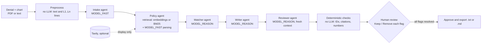

# Appeal-Pilot

> **Synthetic data only · Drafting aid, not medical advice · Clinician sign-off required before use**

Entry for the Nebius x NVIDIA Global AI Hackathon, Best Apps and Agents track.

## What it is

Appeal-Pilot reads a prior-authorization denial letter and the patient's chart notes. It matches chart evidence to the payer's coverage criteria, drafts an appeal letter in which every factual sentence cites a chart line, fact-checks the draft, and waits for a clinician to approve it.

The problem: prior-authorization appeals eat clinician and staff time, and a letter that misstates the chart is worse than no letter. Appeal-Pilot makes each claim traceable to a numbered chart line and flags any claim it can't support.

Nothing is ever sent. Approving only marks the letter final and enables the download.

## Architecture

- **Preprocess:** `app/tools/pdf.py` extracts text and splits the chart into numbered lines. The letter can cite only these IDs.
- **Intake:** `app/agents/intake.py` turns the denial into a structured `Denial`.
- **Policy:** `app/agents/policy.py` queries the policy index (`app/retrieval.py`, top k = 4) with payer + service + denial reason, then extracts the numbered criteria, each tied to its policy ID and section.
- **Matcher:** `app/agents/matcher.py` marks each criterion met, not met or unclear, citing chart line IDs. IDs that aren't in the chart are dropped, and a "met" with no valid evidence is downgraded to "unclear".
- **Writer:** `app/agents/writer.py` argues only from met criteria, and asks for peer-to-peer review for the rest.
- **Reviewer:** `app/agents/reviewer.py` sees only the letter, the chart lines and the criteria, never the writer's reasoning, and flags unsupported sentences.
- **Deterministic checks:** `app/checks.py` flags cited IDs that don't exist, factual sentences with no citation, and numbers or dates missing from the cited lines.
- **Streaming:** `app/pipeline.py` streams each step to the browser over Server-Sent Events.

## How Nebius and NVIDIA are used

- **Endpoint.** Every LLM call goes through `app/llm.py`, which uses the `openai` SDK pointed at **Nebius Token Factory**: `https://api.tokenfactory.nebius.com/v1/`. No other model provider is used.
- **Models.** All chat steps use **NVIDIA Nemotron** models. Their IDs come only from `.env`, as found by `scripts/discover_models.py`:

  | Step | Env var | Model ID |
  |---|---|---|
  | Intake, policy parsing | `MODEL_FAST` | TODO (run `scripts/discover_models.py`), a Nemotron Nano / Lightning model |
  | Matcher, writer, reviewer | `MODEL_REASON` | TODO (run `scripts/discover_models.py`), Nemotron 3 Super |
  | Policy embeddings | `MODEL_EMBED` | TODO (run `scripts/discover_models.py`). Empty means the BM25 fallback |

- **Structured outputs.** Every call requests `response_format: json_schema`, generated from the Pydantic model. If the model rejects that, the client falls back to `json_object` with the schema in the prompt. Replies are validated with Pydantic and retried once, with the validation error fed back to the model. `<think>` blocks and code fences are stripped first. Transport errors (429/5xx) are retried with exponential backoff and jitter, up to 4 attempts. Calls use a 60 s timeout, temperature 0.1 and explicit `max_tokens`.
- **Why the models are tiered.** Extraction and criteria parsing copy fields out of short documents, so a small fast Nemotron handles them cheaply. Matching evidence to criteria, writing a careful argument, and catching unsupported claims need the stronger reasoning model. The reviewer runs on the same model in a fresh context, so it judges the letter without the writer's framing.
- **Usage shown in the UI.** Per-call model, latency and token usage are recorded on the case and shown in the page footer.

## Eval results

`eval/run_eval.py` runs the full pipeline on the 10 bundled cases: 7 where the chart fully supports the appeal, 2 with a genuinely missing criterion, and 1 where the chart contradicts a criterion. It measures:

- **Extraction:** denial fields matched, using normalized exact match. `service` and `denial_reason` are scored by token overlap.
- **Status acc:** criterion status accuracy against `expected.json`.
- **Evidence precision:** the share of cited chart lines that appear in the expected evidence.
- **Citation validity:** the share of factual sentences that pass the deterministic checks.
- **Catch rate:** two fabricated sentences (an impossible date and a symptom absent from the chart) are injected into each draft. The reviewer and checks are re-run, and the rate is the share they flag.
- Latency and tokens per case.

TODO: run `uv run python eval/run_eval.py` with Token Factory credentials, then paste `eval/results.md` here.

## Policy sources

The payers ("Acme Health", "Northwind Care") are fictional, but each of their 15 coverage policies is adapted from a real, publicly available policy: Medicare coverage determinations (CMS), published commercial medical policies, a state Medicaid pharmacy criteria document, and ACR imaging guidance. The criteria thresholds (durations, scores, lab values, BMI) come from those documents. The wording is paraphrased and simplified, and some alternative pathways are moved to the Exceptions section. These files are **not** the current coverage policy of any real payer. Check the source before relying on a criterion.

| Policy | Fictional payer | Service | Adapted from |
|---|---|---|---|
| `AH-SURG-022` | Acme Health | Bariatric surgery | [CMS National Coverage Determination 100.1, Bariatric Surgery for Treatment of Co-Morbid Conditions Related to Morbid Obesity](https://www.cms.gov/medicare-coverage-database/view/ncd.aspx?ncdid=57) |
| `AH-RX-051` | Acme Health | Biologic therapy for plaque psoriasis | [Aetna Clinical Policy Bulletin 0655, Adalimumab, plaque psoriasis](https://www.aetna.com/cpb/medical/data/600_699/0655.html) |
| `AH-DME-019` | Acme Health | Continuous glucose monitor | [CMS Local Coverage Determination L33822, Glucose Monitors (rev. 10/01/2024)](https://www.cms.gov/medicare-coverage-database/view/lcd.aspx?lcdid=33822) |
| `AH-RX-044` | Acme Health | GLP-1 receptor agonist for type 2 diabetes | [OptumRx criteria for Indiana Medicaid, GLP-1 Receptor Agonists and Combinations (07.01.2026), preferred agents (Ozempic)](https://contenthub-aem.optumrx.com/content/dam/contenthub/retail-pharmacy-override/assets/customsite-indiana/documents/quicklinks/20260701_Public-Facing_GLP-1%20RA-GIP-Combinations_PA_Final.pdf) |
| `AH-ORTH-031` | Acme Health | Knee arthroscopy | [Aetna Clinical Policy Bulletin 0673, Knee Arthroscopy / Osteoarthritis of the Knee](https://www.aetna.com/cpb/medical/data/600_699/0673.html) |
| `AH-RAD-012` | Acme Health | MRI lumbar spine | [BlueCross BlueShield of South Carolina Medical Policy CAM 709, MRI Lumbar Spine](https://medicalpolicy.southcarolinablues.com/web/public/brands/medicalpolicy/external/external-policies/mri-lumbar-spine) |
| `AH-REH-003` | Acme Health | Physical therapy visit extension | [CMS Medicare Benefit Policy Manual, Chapter 15, Section 220.3, as summarized in MLN905365, Complying with Outpatient Rehabilitation Therapy Documentation Requirements](https://www.cms.gov/files/document/mln905365-complying-outpatient-rehabilitation-therapy-documentation-requirements.pdf) |
| `AH-SLP-007` | Acme Health | Attended polysomnography | [Aetna Clinical Policy Bulletin 0004, Obstructive Sleep Apnea in Adults, section I.A.1](https://www.aetna.com/cpb/medical/data/1_99/0004.html) |
| `NWC-PH-210` | Northwind Care | Biologic therapy for rheumatoid arthritis | [Aetna Clinical Policy Bulletin 0655, Adalimumab, rheumatoid arthritis](https://www.aetna.com/cpb/medical/data/600_699/0655.html) |
| `NWC-DME-305` | Northwind Care | Continuous glucose monitor | [CMS Local Coverage Determination L33822, Glucose Monitors (rev. 10/01/2024)](https://www.cms.gov/medicare-coverage-database/view/lcd.aspx?lcdid=33822) |
| `NWC-IMG-118` | Northwind Care | CT abdomen and pelvis | [ACR Appropriateness Criteria, Acute Pancreatitis; ACR-NKF consensus statement on intravenous iodinated contrast in kidney disease (Radiology, 2020)](https://acsearch.acr.org/docs/69468/Narrative/) |
| `NWC-RX-220` | Northwind Care | GLP-1 receptor agonist for type 2 diabetes | [OptumRx criteria for Indiana Medicaid, GLP-1 Receptor Agonists and Combinations (07.01.2026), non-preferred agents (Mounjaro)](https://contenthub-aem.optumrx.com/content/dam/contenthub/retail-pharmacy-override/assets/customsite-indiana/documents/quicklinks/20260701_Public-Facing_GLP-1%20RA-GIP-Combinations_PA_Final.pdf) |
| `NWC-ORTH-512` | Northwind Care | Total hip arthroplasty | [Aetna Clinical Policy Bulletin 0287, Hip Arthroplasty](https://www.aetna.com/cpb/medical/data/200_299/0287.html) |
| `NWC-IMG-104` | Northwind Care | MRI lumbar spine | [Molina Clinical Policy, Lumbar Spine MRI](https://www.molinahealthcare.com/providers/tx/PDF/Marketplace/Policy/LumbarSpineMRI.pdf) |
| `NWC-SLP-401` | Northwind Care | Home sleep apnea test | [Aetna Clinical Policy Bulletin 0004, Obstructive Sleep Apnea in Adults, section I.A.2](https://www.aetna.com/cpb/medical/data/1_99/0004.html) |

The 10 bundled cases (denial letters and chart notes) remain fully synthetic. Each case is written against its adapted policy, so the answer key in `expected.json` reflects the real-world criteria.

## Setup

1. Install [uv](https://docs.astral.sh/uv/), then run `uv sync`. This uses Python 3.11.
2. `cp .env.example .env` and set `NEBIUS_API_KEY`.
3. Discover models: `uv run python scripts/discover_models.py`. Copy the recommended `MODEL_FAST`, `MODEL_REASON` and `MODEL_EMBED` lines into `.env`.
4. Run locally: `uv run uvicorn app.main:app --port 8080`, then open http://localhost:8080. Choose a sample case or upload a denial and chart (PDF or `.txt`; demo PDFs are in `data/cases/case_01..03`).
5. Run the eval: `uv run python eval/run_eval.py`. Results are written to `eval/results.md`.
6. Run the tests: `uv run pytest -q`. The tests never call the network; the LLM is mocked.
7. Docker: `docker build -t appeal-pilot .`, then `docker run -p 8080:8080 --env-file .env appeal-pilot`.
8. Regenerate the demo PDFs: `uv run python scripts/make_pdfs.py`.

Runs are rate-limited per IP (`MAX_RUNS_PER_IP_PER_HOUR`, default 10) to protect credits on the public demo. Behind a reverse proxy, set `TRUST_PROXY=true` so the limit uses the proxy-appended client IP; otherwise `X-Forwarded-For` is ignored. The demo needs no login. Tavily search is optional and off by default (`ENABLE_TAVILY=false`). Its results are shown as external references only and are never used for matching.

Hosted demo: TODO (deployment URL).

## Disclaimer

All patients, members, clinicians and payers ("Acme Health", "Northwind Care") in this repository are **fictional**, and all case data is **synthetic**. The coverage policies are simplified adaptations of public policies (see [Policy sources](#policy-sources)), not any payer's current coverage rules. Appeal-Pilot is a drafting aid. It is **not medical advice** and does not make coverage determinations. A licensed clinician must review, edit and sign off on every letter before use. The app never sends anything.

## License

MIT. See [LICENSE](LICENSE).
