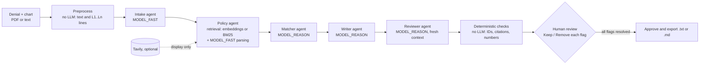

# Appeal-Pilot

> **Synthetic data only · Drafting aid, not medical advice · Clinician sign-off required before use**

Drafts prior-authorization appeal letters in which every factual sentence cites the patient's chart, then fact-checks itself before a clinician signs off. Built on **NVIDIA Nemotron** models served by **Nebius Token Factory**.

Entry for the Nebius x NVIDIA Global AI Hackathon, Best Apps and Agents track.

- **Live demo:** (deployment URL coming soon; no login needed)
- **Code walkthrough:** [CODE_GUIDE.md](CODE_GUIDE.md) explains every file and function

## What it is

When an insurer denies a prior-authorization request, someone has to write an appeal. They read the denial, find the payer's coverage criteria, dig through the chart for evidence, and argue the case. That costs clinicians and staff hours, and a letter that misstates the chart is worse than no letter.

Appeal-Pilot does the legwork and keeps every claim traceable:

1. **Upload** a denial letter and chart notes (PDF or text), or pick one of the 10 sample cases.
2. **Watch it work.** A live step tracker shows each agent as it runs: it reads the denial, retrieves the matching policy, checks each coverage criterion against the chart, drafts the letter and fact-checks it.
3. **See the evidence.** Each criterion is marked *met*, *not met* or *unclear*. Click one to highlight the chart lines that prove it. Hover a sentence of the letter to see what it cites.
4. **Review the flags.** Sentences the fact-checker can't verify are flagged. Choose **Keep** or **Remove** for each, and edit any sentence in place.
5. **Approve and download.** Approval is blocked until every flag is resolved. Nothing is ever sent: approving only marks the letter final and enables the `.txt` / `.md` download.

When the chart doesn't support a criterion, the letter doesn't pretend it does. It requests a peer-to-peer review for that criterion instead.

## Architecture



| Step | File | What it does |
|---|---|---|
| Preprocess | `app/tools/pdf.py` | Extracts text and numbers the chart `L1…Ln`. The letter can cite only these IDs |
| Intake | `app/agents/intake.py` | Turns the denial into structured fields: payer, service, codes, reason, dates |
| Policy | `app/agents/policy.py`, `app/retrieval.py` | Retrieves the payer's policy (the one the denial cites, if it names one) and extracts its numbered criteria. Never mixes policies or payers |
| Matcher | `app/agents/matcher.py` | Marks each criterion met / not met / unclear with evidence lines. A "met" with no valid evidence is downgraded to "unclear" |
| Writer | `app/agents/writer.py` | Argues only from met criteria; every factual sentence carries citations |
| Reviewer | `app/agents/reviewer.py` | An independent fact-check. It sees only the letter and the sources, never the writer's reasoning |
| Checks | `app/checks.py` | Rule-based, no LLM: flags unknown citations, uncited facts, and numbers or dates absent from the cited sources |

Progress streams to the browser over Server-Sent Events (`app/pipeline.py`, `app/main.py`). The UI is a single dependency-free page (`static/index.html`).

## How Nebius and NVIDIA are used

- **One endpoint.** Every LLM call goes through `app/llm.py`, which uses the `openai` SDK pointed at **Nebius Token Factory** (`https://api.tokenfactory.nebius.com/v1/`). No other model provider is used.
- **Nemotron for every chat step**, tiered by difficulty:

  | Steps | Env var | Model |
  |---|---|---|
  | Intake, policy parsing | `MODEL_FAST` | `nvidia/NVIDIA-Nemotron-3-Nano-30B-A3B` |
  | Matcher, writer, reviewer | `MODEL_REASON` | `nvidia/nemotron-3-super-120b-a12b` |
  | Policy search embeddings | `MODEL_EMBED` | `Qwen/Qwen3-Embedding-8B` (optional; leave empty to use BM25 keyword search) |

  Extraction copies fields out of short documents, so the small, fast Nano model handles it cheaply. Matching evidence, writing a careful argument and catching unsupported claims need the stronger Super model. The reviewer runs on that same model in a fresh context, so it judges the letter without the writer's framing.
- **Model discovery.** `scripts/discover_models.py` lists the models your key can use and probes each Nemotron model for `json_schema`, `json_object` and tool calling. On our account, Nemotron 3 Nano 30B, Nemotron 3 Super 120B, Nemotron Ultra 550B and Nemotron 3.5 Super VL passed all three probes. The Nemotron Lightning model failed both JSON modes, so it isn't used.
- **Structured outputs.** Every call requests `response_format: json_schema`, generated from a Pydantic model. If a model rejects that, the client falls back to `json_object` with the schema in the prompt. Replies are validated with Pydantic, and one retry feeds the validation error back to the model. `<think>` blocks and code fences are stripped first. 429 and 5xx errors are retried with exponential backoff and jitter, up to 4 attempts. Calls use a 60 s timeout, temperature 0.1 and explicit `max_tokens`.
- **Usage in the UI.** The page footer shows each call's model, latency and token count.

## Eval results

`eval/run_eval.py` runs the full pipeline on the 10 bundled cases: 7 where the chart supports the appeal, 2 with a missing criterion, and 1 where the chart contradicts a criterion. It scores each case against its `expected.json` answer key:

| Metric | Meaning |
|---|---|
| Extraction | Denial fields extracted correctly (dates in any format; free text by word overlap) |
| Status acc | Criteria given the right met / not met / unclear verdict |
| Evidence precision | Cited chart lines that appear in the answer key |
| Citation validity | Factual sentences that pass the rule-based checks |
| Catch rate | Two fabricated sentences (an impossible date and a symptom absent from the chart) are injected into each letter; the share the reviewer and checks flag |
| Latency, tokens | Per case |

Run it with `uv run python eval/run_eval.py`; results are written to `eval/results.md`. It makes about 50 Token Factory calls, so it uses credits. Live results will be added here.

## Policy sources

The payers ("Acme Health", "Northwind Care") are fictional, but each of their 15 coverage policies is adapted from a real, publicly available policy: Medicare coverage determinations (CMS), published commercial medical policies, a state Medicaid pharmacy criteria document, and ACR imaging guidance. The criteria thresholds (durations, scores, lab values, BMI) come from those documents. The wording is paraphrased and simplified, and some alternative pathways are moved to the Exceptions section. These files are **not** the current coverage policy of any real payer. Check the source before relying on a criterion.

| Policy | Fictional payer | Service | Adapted from |
|---|---|---|---|
| `AH-SURG-022` | Acme Health | Bariatric surgery | [CMS National Coverage Determination 100.1, Bariatric Surgery for Treatment of Co-Morbid Conditions Related to Morbid Obesity](https://www.cms.gov/medicare-coverage-database/view/ncd.aspx?ncdid=57) |
| `AH-RX-051` | Acme Health | Biologic therapy for plaque psoriasis | [Aetna Clinical Policy Bulletin 0655, Adalimumab, plaque psoriasis](https://www.aetna.com/cpb/medical/data/600_699/0655.html) |
| `AH-DME-019` | Acme Health | Continuous glucose monitor | [CMS Local Coverage Determination L33822, Glucose Monitors (rev. 10/01/2024)](https://www.cms.gov/medicare-coverage-database/view/lcd.aspx?lcdid=33822) |
| `AH-RX-044` | Acme Health | GLP-1 receptor agonist for type 2 diabetes | [OptumRx criteria for Indiana Medicaid, GLP-1 Receptor Agonists and Combinations (07.01.2026), preferred agents (Ozempic)](https://contenthub-aem.optumrx.com/content/dam/contenthub/retail-pharmacy-override/assets/customsite-indiana/documents/quicklinks/20260701_Public-Facing_GLP-1%20RA-GIP-Combinations_PA_Final.pdf) |
| `AH-ORTH-031` | Acme Health | Knee arthroscopy | [Aetna Clinical Policy Bulletin 0673, Knee Arthroscopy / Osteoarthritis of the Knee](https://www.aetna.com/cpb/medical/data/600_699/0673.html) |
| `AH-RAD-012` | Acme Health | MRI lumbar spine | [BlueCross BlueShield of South Carolina Medical Policy CAM 709, MRI Lumbar Spine](https://medicalpolicy.southcarolinablues.com/web/public/brands/medicalpolicy/external/external-policies/mri-lumbar-spine) |
| `AH-REH-003` | Acme Health | Physical therapy visit extension | [CMS Medicare Benefit Policy Manual, Chapter 15, Section 220.3, as summarized in MLN905365, Complying with Outpatient Rehabilitation Therapy Documentation Requirements](https://www.cms.gov/files/document/mln905365-complying-outpatient-rehabilitation-therapy-documentation-requirements.pdf) |
| `AH-SLP-007` | Acme Health | Attended polysomnography | [Aetna Clinical Policy Bulletin 0004, Obstructive Sleep Apnea in Adults, section I.A.1](https://www.aetna.com/cpb/medical/data/1_99/0004.html) |
| `NWC-PH-210` | Northwind Care | Biologic therapy for rheumatoid arthritis | [Aetna Clinical Policy Bulletin 0655, Adalimumab, rheumatoid arthritis](https://www.aetna.com/cpb/medical/data/600_699/0655.html) |
| `NWC-DME-305` | Northwind Care | Continuous glucose monitor | [CMS Local Coverage Determination L33822, Glucose Monitors (rev. 10/01/2024)](https://www.cms.gov/medicare-coverage-database/view/lcd.aspx?lcdid=33822) |
| `NWC-IMG-118` | Northwind Care | CT abdomen and pelvis | [ACR Appropriateness Criteria, Acute Pancreatitis; ACR-NKF consensus statement on intravenous iodinated contrast in kidney disease (Radiology, 2020)](https://acsearch.acr.org/docs/69468/Narrative/) |
| `NWC-RX-220` | Northwind Care | GLP-1 receptor agonist for type 2 diabetes | [OptumRx criteria for Indiana Medicaid, GLP-1 Receptor Agonists and Combinations (07.01.2026), non-preferred agents (Mounjaro)](https://contenthub-aem.optumrx.com/content/dam/contenthub/retail-pharmacy-override/assets/customsite-indiana/documents/quicklinks/20260701_Public-Facing_GLP-1%20RA-GIP-Combinations_PA_Final.pdf) |
| `NWC-ORTH-512` | Northwind Care | Total hip arthroplasty | [Aetna Clinical Policy Bulletin 0287, Hip Arthroplasty](https://www.aetna.com/cpb/medical/data/200_299/0287.html) |
| `NWC-IMG-104` | Northwind Care | MRI lumbar spine | [Molina Clinical Policy, Lumbar Spine MRI](https://www.molinahealthcare.com/providers/tx/PDF/Marketplace/Policy/LumbarSpineMRI.pdf) |
| `NWC-SLP-401` | Northwind Care | Home sleep apnea test | [Aetna Clinical Policy Bulletin 0004, Obstructive Sleep Apnea in Adults, section I.A.2](https://www.aetna.com/cpb/medical/data/1_99/0004.html) |

The 10 bundled cases (denial letters and chart notes) remain fully synthetic. Each case is written against its adapted policy, so the answer key in `expected.json` reflects the real-world criteria.

## Denial realism

The 10 sample denials are synthetic, but they follow the patterns in real, de-identified [California DMHC Independent Medical Review decisions](https://data.ca.gov/dataset/independent-medical-review-imr-determinations-trend), which are public data. Real plans almost always say a denied service is "not medically necessary" and then name the specific criterion that wasn't met. About 70% of IMR decisions are medical-necessity disputes. The sample letters do the same, and they also tell the member about the right to independent external review.

[`data/imr_patterns.md`](data/imr_patterns.md) lists, for each service in this app, how many real IMR decisions match it, how often the plan's denial was overturned, and the most common review themes. Examples: conservative therapy for lumbar MRI, BMI for bariatric surgery, insulin use for CGM, and step therapy for biologics. To regenerate it from the dataset's CSV, run `uv run python scripts/imr_patterns.py imr.csv > data/imr_patterns.md`. The committed copy was built from a mirror of the dataset covering 2001–2016, and services are matched by keyword, so the counts are approximate. No IMR text is bundled in this repo.

## Setup

You need [uv](https://docs.astral.sh/uv/) and a Nebius Token Factory API key.

```bash
git clone https://github.com/Kapowsh/Appeal-Pilot.git && cd Appeal-Pilot
uv sync                                   # installs Python 3.11 and the dependencies
cp .env.example .env                      # then set NEBIUS_API_KEY and the MODEL_* values
uv run uvicorn app.main:app --port 8080   # open http://localhost:8080
```

- Not sure which models your key can use? Run `uv run python scripts/discover_models.py` and copy the recommended `MODEL_*` lines into `.env`.
- Upload a denial and chart as PDF or `.txt`, or pick a sample. Demo PDFs are in `data/cases/case_01..03`.
- Run the tests: `uv run pytest -q`. They never touch the network; the LLM is mocked.
- Regenerate the demo PDFs: `uv run python scripts/make_pdfs.py`.

### Settings (`.env`)

| Variable | Default | Purpose |
|---|---|---|
| `NEBIUS_API_KEY` | (required) | Token Factory key |
| `MODEL_FAST`, `MODEL_REASON` | (required) | Nemotron model IDs (see the table above) |
| `MODEL_EMBED` | empty | Embeddings model; empty uses BM25 keyword search |
| `MAX_RUNS_PER_IP_PER_HOUR` | `10` | Per-visitor rate limit, to protect credits on the public demo |
| `TRUST_PROXY` | `false` | Set `true` behind a reverse proxy, so the rate limit sees real visitor IPs |
| `ENABLE_TAVILY`, `TAVILY_API_KEY` | off | Optional web search, shown as "external references" only and never used as evidence |

## Deploy

The app ships as a Docker image (`Dockerfile`: Python 3.11 slim, uvicorn on port 8080). Run exactly **one instance**: cases are held in memory, and a restart clears runs in progress.

**Render (what the demo uses):**
1. On render.com, choose **New → Web Service**, select this repo, and pick the **Docker** runtime on branch `main`.
2. Set the health check path to `/healthz`.
3. Add the environment variables `NEBIUS_API_KEY`, `MODEL_FAST`, `MODEL_REASON`, `MODEL_EMBED`, `TRUST_PROXY=true` and `PORT=8080`.
4. Deploy. Every push to `main` redeploys.

On Render's free plan the app sleeps after about 15 idle minutes, so the first visit after that takes around 30 seconds.

**Any Docker host (e.g. a Nebius AI Cloud VM):**
```bash
docker build -t appeal-pilot .
docker run -d --restart unless-stopped -p 80:8080 --env-file .env appeal-pilot
```
Add `TRUST_PROXY=true` to `.env` if a reverse proxy sits in front of the app.

The demo needs no login. Keep your API key in the host's environment variables, never in the repo.

## Disclaimer

All patients, members, clinicians and payers ("Acme Health", "Northwind Care") in this repository are **fictional**, and all case data is **synthetic**. The coverage policies are simplified adaptations of public policies (see [Policy sources](#policy-sources)), not any payer's current coverage rules. Appeal-Pilot is a drafting aid. It is **not medical advice** and does not make coverage determinations. A licensed clinician must review, edit and sign off on every letter before use. The app never sends anything.

## License

MIT. See [LICENSE](LICENSE).
