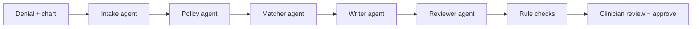

# Appeal-Pilot

Appeal-Pilot turns an insurance prior-authorization denial into a ready-to-review appeal letter. Every factual claim in the letter cites the patient's chart, and the letter is fact-checked before a clinician signs off.

## The problem

Prior authorization denials are common, and most are never challenged even though appeals usually win.

- **Appeals succeed but are rarely filed.** In 2024, Medicare Advantage insurers fully or partially denied 4.1 million prior authorization requests. Only 11.5% of those denials were appealed, yet 80.7% of appeals were fully or partially overturned ([KFF](https://www.kff.org/medicare/medicare-advantage-insurers-made-nearly-53-million-prior-authorization-determinations-in-2024/)).
- **Clinicians lack the time.** Physicians handle about 40 prior authorizations a week and spend about 13 hours a week on them ([AMA survey, via CMA](https://cmadocs.org/newsroom/news/view/ArticleId/51200/AMA-survey-highlights-ongoing-prior-auth-burdens-as-CMA-continues-reform-efforts)).
- **Accuracy matters.** A strong appeal has to match each of the payer's coverage criteria to evidence in the chart, and a letter that misstates the chart can do more harm than no letter.

The result is that patients go without care their plan would have covered, simply because no one had time to write the appeal. Appeal-Pilot cuts that work to a review-and-approve step while keeping a clinician in control of every word.

## What it does

1. **Upload** a denial letter and chart notes (PDF or text), or pick one of 10 sample cases.
2. **Agents do the legwork**, with live progress on screen: they read the denial, find the payer's coverage criteria, check each criterion against the chart, and draft the appeal.
3. **Every claim is traceable.** Each criterion is marked *met*, *not met* or *unclear*, with the chart lines that prove it. Each sentence of the letter cites its sources.
4. **Built-in fact-check.** An independent reviewer agent and rule-based checks flag any sentence the chart doesn't support. You keep or remove each flagged sentence, and you can edit any sentence.
5. **Approve and download.** Nothing is ever sent. Approval only finalizes the letter for export.

When the chart doesn't support a criterion, the letter never claims it does. It asks for a peer-to-peer review instead.



## Hackathon requirements

| Runs on Nebius | Every LLM call goes through **Nebius Token Factory** (`https://api.tokenfactory.nebius.com/v1/`). No other model provider is used |
| Uses NVIDIA open models | All five agents run on **NVIDIA Nemotron**: `nvidia/NVIDIA-Nemotron-3-Nano-30B-A3B` for fast extraction, and `nvidia/nemotron-3-super-120b-a12b` for matching, writing and review |
| Best Apps and Agents | A multi-agent pipeline with structured outputs, a separate fact-checking agent, and a human approval step |
The 15 coverage policies are adapted from real public policies (CMS, Aetna, BCBS and others; each file cites its source). The sample denials follow real denial patterns from California's public independent medical review decisions.

## Run it

Requires Python 3.11+.

```bash
pip install -r requirements.txt
cp .env.example .env    # add NEBIUS_API_KEY and the MODEL_* IDs
uvicorn app.main:app --port 8080
```


## License

MIT. See [LICENSE](LICENSE).
