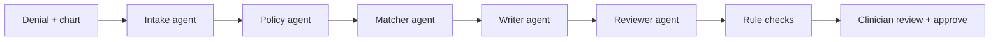

# Appeal-Pilot

> **Synthetic data only · Drafting aid, not medical advice · Clinician sign-off required before use**

Appeal-Pilot turns an insurance prior-authorization denial into a ready-to-review appeal letter. Every factual claim in the letter cites the patient's chart, and the letter is fact-checked before a clinician signs off.

**Live demo:** (coming soon, no login needed) · Entry for the **Nebius x NVIDIA Global AI Hackathon**, Best Apps and Agents track.

## What it does

1. **Upload** a denial letter and chart notes (PDF or text), or pick one of 10 sample cases.
2. **Agents do the legwork**, with live progress on screen: they read the denial, find the payer's coverage criteria, check each criterion against the chart, and draft the appeal.
3. **Every claim is traceable.** Each criterion is marked *met*, *not met* or *unclear*, with the chart lines that prove it. Each sentence of the letter cites its sources.
4. **Built-in fact-check.** An independent reviewer agent and rule-based checks flag any sentence the chart doesn't support. You keep or remove each flagged sentence, and you can edit any sentence.
5. **Approve and download.** Nothing is ever sent. Approval only finalizes the letter for export.

When the chart doesn't support a criterion, the letter never claims it does. It asks for a peer-to-peer review instead.



## Hackathon requirements

| Requirement | How Appeal-Pilot meets it |
|---|---|
| Runs on Nebius | Every LLM call goes through **Nebius Token Factory** (`https://api.tokenfactory.nebius.com/v1/`). No other model provider is used |
| Uses NVIDIA open models | All five agents run on **NVIDIA Nemotron**: `nvidia/NVIDIA-Nemotron-3-Nano-30B-A3B` for fast extraction, and `nvidia/nemotron-3-super-120b-a12b` for matching, writing and review |
| Best Apps and Agents | A multi-agent pipeline with structured outputs, a separate fact-checking agent, and a human approval step |
| Public, open source | Public GitHub repo under the MIT license |
| Hosted demo | A Docker container with a public URL and no login. Runs are rate-limited per visitor to protect credits |
| Responsible use | Synthetic data only, fictional payers ("Acme Health", "Northwind Care"), a visible disclaimer banner, and no real patient data |

The 15 coverage policies are adapted from real public policies (CMS, Aetna, BCBS and others; each file cites its source). The sample denials follow real denial patterns from California's public independent medical review decisions ([`data/imr_patterns.md`](data/imr_patterns.md)).

## Run it

```bash
uv sync
cp .env.example .env    # add NEBIUS_API_KEY and the MODEL_* IDs
uv run uvicorn app.main:app --port 8080
```

Open http://localhost:8080. To run the tests: `uv run pytest -q`.

**Deploy:** build the `Dockerfile` on any container host (e.g. Render or a Nebius VM). Set the same variables as in `.env`, plus `TRUST_PROXY=true` when the host puts a proxy in front of the app.

## Disclaimer

All people, payers and cases are fictional. Appeal-Pilot is a drafting aid, not medical advice, and it makes no coverage decisions. A licensed clinician must review and sign every letter.

## License

MIT. See [LICENSE](LICENSE).
